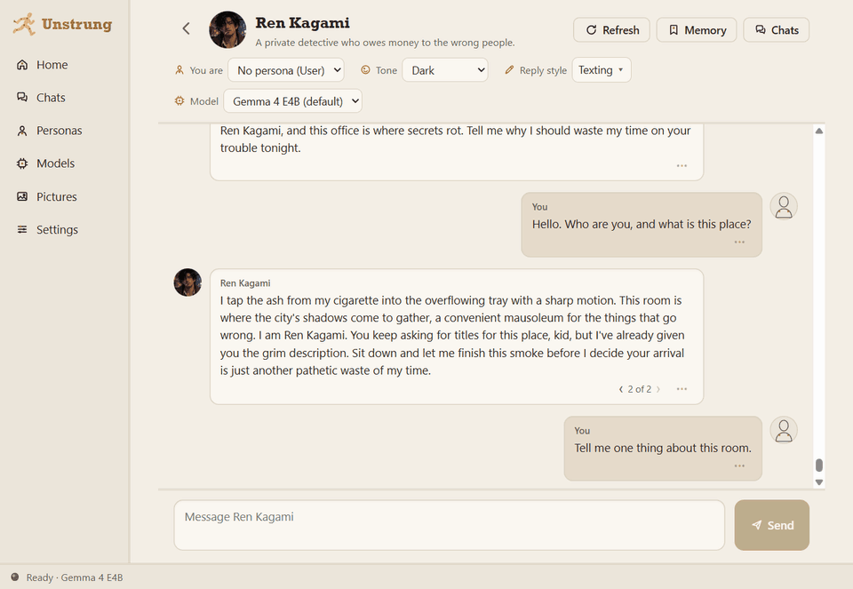

# Unstrung

Your characters. Your computer. Nothing leaves it.



Unstrung is a desktop app for roleplay chat with AI characters. All processing is local. The app does not send chats, pictures or telemetry to the cloud. It goes online only to download engines and models, and to check for app updates, which you can turn off.

Status: all eight phases are done, except code signing. The installer is not signed yet.

## Install

1. Run `Unstrung_0.2.0_x64-setup.exe`. It installs for your Windows user only and needs no administrator rights. The installer is not signed yet, so Windows SmartScreen can show "Windows protected your PC". To go on, click More info, then Run anyway. To make sure that the download is the real one, compare its SHA-256 hash with the release's `SHA256SUMS.txt`, as [SECURITY.md](SECURITY.md#check-your-download) shows.
2. Start Unstrung. The welcome flow asks where to keep your pictures and models, then downloads two things:
   - The chat engine (Ollama 0.40.13), about 1.6 GB. AMD graphics cards get an extra 0.26 GB.
   - One chat model, 3.3 GB to 6.6 GB. The app suggests a model that fits your PC.
3. Pick a persona or skip that step, then start a chat.

You can close Unstrung during the downloads. The next start goes on from where it stopped.

## Requirements

- Windows 10 or 11, 64-bit
- About 10 GB of free disk space for the engine and one model
- A graphics card is optional. Without one the chats work, but replies are slow.

## Where your data is

| Folder | Holds |
| --- | --- |
| `%LOCALAPPDATA%\Unstrung` | The chats database (`app.db`), profile pictures, logs, the chat engine, and copies of the database from before each update that changes it (`backups`) |
| The library folder that you picked in the welcome flow | Pictures. By default it is inside the app folder. |
| The models folder that you picked in the welcome flow | The chat models. By default it is inside the app folder. |

The database always stays in the app folder, so a sync tool such as OneDrive cannot damage it.

Your chats and pictures are encrypted with a key that Windows keeps for your Windows user account. Only that account on this PC can open them. A copy of the app folder on another PC, or after you reinstall Windows, does not open. Before you move to a new PC or reinstall Windows, go to Settings and click Export everything. On the new system, click Import backup in Settings. The backup zip is not encrypted, so keep it in a safe place.

## When something goes wrong

The Start menu has a shortcut named "Unstrung (Safe start)". It opens the app without the chat engine and offers Repair: a quick check, or a full check that also tests every model file. If the app fails to start two times in a row, the next start opens safe start by itself.

## Uninstall

Use Settings, Apps, Installed apps. The uninstaller asks if it must also delete your chats, characters, pictures and models. If you leave that box clear, your data stays, and a new install for the same Windows user finds it again. After a Windows reinstall the old data does not open, so export a backup first.

## Build from source

You need Rust (stable), Node.js 22 or newer, the Visual Studio C++ build tools, and [Strawberry Perl](https://strawberryperl.com/). The chats file is encrypted with SQLCipher, and the build compiles OpenSSL from source, which needs a full Perl.

If another Perl comes first on your PATH (for example the one in Git Bash), set `PERL` to Strawberry Perl before you build:

```
set PERL=C:\Strawberry\perl\bin\perl.exe
```

1. Build the UI. The app embeds it, so you must build it before the Rust code.

   ```
   cd ui
   npm ci
   npm run build
   cd ..
   ```

2. Build and start the app:

   ```
   cargo run -p unstrung-app
   ```

3. To make the installer, install the Tauri CLI (`cargo install tauri-cli --version 2.12.4 --locked`), then run this:

   ```
   cd crates/unstrung-app
   cargo tauri build
   ```

   The installer is in `target/release/bundle/nsis`. The build also signs the update files, so it needs the updater's private key in `TAURI_SIGNING_PRIVATE_KEY` and its password in `TAURI_SIGNING_PRIVATE_KEY_PASSWORD`. Without the key, the build fails.

4. To publish a release, follow [RELEASING.md](RELEASING.md): it has the version steps, the update test and the publish steps. The release workflow builds the installer, signs the update, and makes a draft release with `latest.json` and the notes from [CHANGELOG.md](CHANGELOG.md). The workflow needs the two values above as repository secrets with the same names.

The app starts its own private Ollama process on a random port on `127.0.0.1`. It does not use or change the Ollama that you run yourself.

A debug build reads models from your own Ollama folder (`%USERPROFILE%\.ollama\models`), so you do not download them twice. If the app folder has no engine, a debug build also uses your installed Ollama program. A debug build also keeps its data in `%LOCALAPPDATA%\Unstrung-dev`, so a test build never opens the chats of your installed Unstrung. A release build uses only its own engine and its own models folder. To point a build at another models folder, set `UNSTRUNG_DEV_OLLAMA_MODELS`. To use a different app folder, for example for a test, set `UNSTRUNG_HOME`.

## Tests

```
cargo test --workspace
```

These tests need the chat engine and a model, so they do not run by default:

```
cargo test -p unstrung-core --test live_chat -- --ignored --nocapture
```

The app also has a self-test. It sends one message through the real window and command path, writes `logs/self-test.json`, and exits with code 0 (pass) or 1 (fail). Run it two times on an empty folder. The second run must open with the history of the first run.

```
set UNSTRUNG_HOME=%TEMP%\unstrung-test
target\debug\unstrung-app.exe --self-test --background
```

`--background` opens the window without focus.

## Report a bug

Open an issue at [github.com/Codex-Crusader/unstrung/issues](https://github.com/Codex-Crusader/unstrung/issues). In Unstrung, go to Settings and click Copy diagnostic report, then paste the report into the issue. The report has the app version and the last log lines. It has no chat text and no user name. If the app does not start, open "Unstrung (Safe start)" from the Start menu and copy the report there.

## Security

To report a security bug, do not open a public issue. Use GitHub private vulnerability reporting: open the Security tab of this repository and click Report a vulnerability. [SECURITY.md](SECURITY.md) has the full policy: what Unstrung protects, what it sends over the network, and what it does not protect.

## License

MIT. Copyright Bhargavaram Krishnapur. See [LICENSE](LICENSE).

Tauri needs five crates under MPL-2.0 (`cssparser`, `cssparser-macros`, `dtoa-short`, `option-ext`, `selectors`). Unstrung uses them unchanged. `deny.toml` lists them by name.
